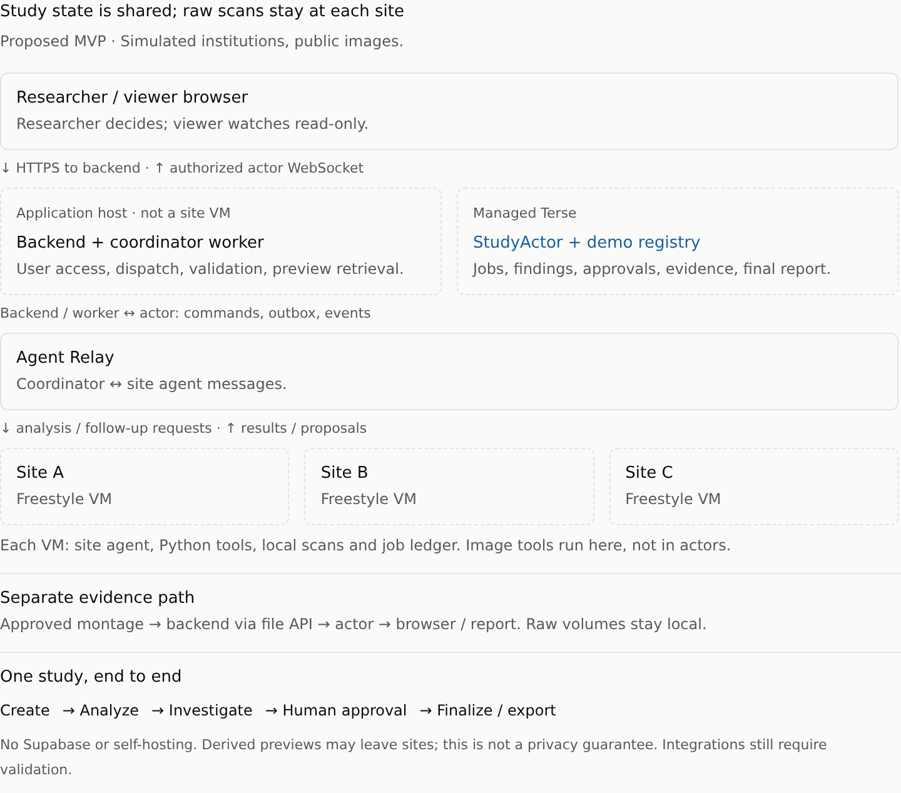

# MVP technical specification: federated imaging study

Status: the voxel-analysis pipeline, public MRI fixture, durable site runner, Terse study actors/coordinator, and authenticated create/run/results/retry browser screen are implemented. Browser validation uses real local Terse, Python, and SQLite with explicitly in-memory messaging. A separate single-site Freestyle/hosted Relay gate passed, including crash and pause/resume recovery. The managed application has not been deployed or tested end to end. See [README](README.md) for runnable commands.

**Current phase, not full MVP acceptance:** React/Vite serves the approved flat study workspace; backend-only actor calls enforce signed 12-hour HttpOnly researcher sessions, exact-Origin JSON writes, owner checks, revisions, and command replay. Evidence routes return only actor-persisted PNGs by accepted hash, never arbitrary site paths. Browser snapshots refresh every two seconds, with stale-state warnings; direct managed subscriptions and viewer capabilities remain deferred. Reload preview retries HTTP retrieval only; generation failures currently require site retry, not the planned independent retry-preview operation. LLM investigation, human decisions, finalization, exports, and reservation release remain unimplemented. The active study retains its site reservation through review. U1–U6 below describe the intended complete MVP, not current acceptance.

User contract: [MVP_USER_SPEC.md](MVP_USER_SPEC.md). Workflow IDs U1–U6 are shared between the documents. If implementation changes a user-visible contract, update both specs together.

## Visual architecture reference

[Responsive HTML reference and diagram source](docs/architecture.html). Arrows distinguish application commands, agent messages, and the separate permitted-evidence transfer. The diagram is a proposed design, not deployment evidence.

## 1. Architecture and ownership

| Component | Responsibility | Explicit boundary |
| --- | --- | --- |
| React + TypeScript web app | Study workspace, evidence review, approvals, exports | No provider credentials; no direct VM access |
| TypeScript application server | Demo authorization, actor client, WebSocket grants, approved evidence retrieval | No raw-image analysis; no unrestricted file proxy |
| Managed Terse StudyActor, one per study | Authoritative workflow state, jobs/outbox, findings, decisions, bounded evidence, report | No heavy image processing or long-running LLM calls |
| Coordinator worker, TypeScript + OpenAI tool calling | Dispatch requests, ask bounded follow-up questions, validate responses, submit events to actor | Cannot read raw site files or approve resolutions |
| Three Freestyle site VMs | One site agent each, local manifests/volumes, Python tools, job ledger | Each has only its site's dataset and scoped messaging identity |
| Agent Relay | Coordinator/site requests, investigation exchanges, result delivery | Not the authoritative study ledger |

Application server and coordinator worker will share one process in one Render Web Service for the demo; their responsibilities remain separate. Start with free compute for the HTTP bootstrap only; uninterrupted coordination requires an approved upgrade or a revised execution design. Freestyle VMs are provisioned before the demo, not once per scan. One active analysis attempt per site is supported. Reject overlapping studies using a busy site with a visible start error rather than silently queueing unbounded work.

One small managed DemoRegistryActor persists created study IDs for worker recovery and an exclusive active-study reservation for the three-site demo pool. Start reserves by study/command ID before dispatch; retries resume that reservation. Finalization releases it idempotently, with worker reconciliation repairing a missed release. A start rejected as busy leaves the requesting study in Draft. This registry is not a user-facing study catalog or a second copy of study state.

The central operator controls these demo VMs. This is an orchestrated system simulating federated access boundaries, not proof of organizational independence. Managed actors and Relay receive shared findings; external LLM providers receive only permitted text/measurements, not raw volumes or previews in v1.

### Render application hosting

- Begin with one free Render Web Service for the minimal HTTP bootstrap. `render.yaml` pins the free plan, `npm start`, and `/healthz`; `.node-version` pins Node 24.22.1. The server binds to `0.0.0.0` on Render's assigned `PORT`, reports bootstrap status at `/`, and implements SIGTERM shutdown. The deployed bootstrap does not serve React, study routes, or a coordinator, and needs no provider secrets. Local application code now opts into these with explicit private configuration and a frontend build. Auto-deploy is off; deployments are explicit.
- The intended full application serves the React build, study-URL fallbacks, and backend routes from this one HTTPS origin. Start the coordinator with the HTTP server, maintain its Relay connection independently of browser requests, and reconcile persisted pending work on startup and reconnect. Run analysis records intent in Terse and returns promptly. Vercel and a separate worker deployment are not required.
- Free services spin down after 15 minutes without inbound traffic, so the bootstrap does **not** establish continued coordination after the browser closes. Outbound Relay polling and direct browser-to-Terse subscriptions do not keep Render awake. Upgrade to always-running paid compute only with approval, or revise the execution design, before claiming the uninterrupted-workflow contract. Even paid compute must tolerate restarts.
- Browser live subscriptions connect to managed Terse using backend-authorized, scoped WebSocket grants. Render hosts the application, not the actor runtime or site analysis. Terse, Freestyle, Agent Relay, and OpenAI remain managed integrations.
- Keep authoritative study state, job/outbox records, registry data, and accepted evidence in Terse, not Render memory or local disk. No Render persistent disk, separate application database, Redis, or object store is required for this bounded MVP.
- A deployment restarts both the HTTP server and coordinator. Reconcile from Terse and the site ledgers after restart; preserve stable request IDs and deduplication even if old and new deployments briefly overlap. One configured replica is not an exactly-once execution guarantee.
- Configure backend/provider credentials and stable session/viewer signing material as server-only Render environment variables, never frontend build variables. Preview environments must not inherit credentials that dispatch work against the shared demo sites.

### Freestyle workspace lifecycle

Freestyle is used for persistent site workbenches, not per-scan ephemeral execution or production web-app hosting. Its onboarding guide cautions that short, cheaply retryable scripts alone do not justify the platform. Here the intended benefit is retaining datasets, prepared Python environments, agent sessions, and the job ledger across repeated investigations. Benchmark that benefit; do not claim VM persistence is required for a three-minute analysis.

- Prepare a credential-free base snapshot containing the site runner, Node runtime, Python virtual environment at `/opt/venv`, and pinned analysis dependencies. Create three distinct persistent VMs from it; install each site's own dataset and credentials afterward. Never snapshot a populated site to create another institution's workspace.
- Run site agents as supervised systemd services inside Freestyle. Use absolute executable paths and explicit environment settings: `vm.exec` is a non-login shell with a bare PATH and no HOME. It buffers output until completion, so use structured Relay progress events, not stdout as a live progress stream.
- Keep VMs running while analysis, investigations, or approvals may require more work. Network-idle auto-pause can interrupt CPU work; do not use it as a job-completion detector. Before new work explicitly start paused VMs and confirm runner health, then dispatch through Relay. Starting a VM is infrastructure control, not a second analysis command channel.
- Prefer pause when idle after finalization; it preserves memory and disk. A stopped persistent VM retains disk but loses processes/memory, so boot supervision and the local job ledger must recover. Ephemeral VMs may be deleted on stop and are not suitable here.
- Persist VM IDs and effective TTL, auto-delete, and runtime budgets in the registry's site configuration. Read back effective plan policies; unlimited retention is not assumed. Operator cleanup requires authorization and follows final evidence persistence.
- Keep the Freestyle team API key in the trusted backend only. Site runners receive no team-level infrastructure credentials. Where a service needs platform access, use an identity restricted to its assigned VM and Linux user; viewer browsers receive no VM token.

OpenAI calls from a site use Freestyle's documented outbound TLS credential injection, with a placeholder key in the guest and the actual provider key configured at the edge. Grant the required Responses endpoint/model and configure Node's CA trust without disabling certificate verification. Relay authentication remains a separate site-scoped credential. A transform's path match does not itself deny other requests; network and provider permissions still need explicit restriction. This integration is a gate, not a compliance assertion.

## 2. Integration checks before building the full UI

1. Obtain a licensed public T1 NIfTI fixture; verify orientation, valid signal, redistribution, and attribution. Use six selected acquisitions plus an alternate, with synthetic derivatives as in the user spec.
2. Execute the Python pipeline in a Freestyle VM. Record CPU, memory, scan runtime, download size, and montage size. Target a complete warm demo run within three minutes; this is a benchmark gate, not a latency guarantee.
3. Prove a coordinator and one site agent can exchange structured messages over the selected Relay interface from Freestyle. Pin a working version and verify identity, delivery/reconnection behavior, and credentials. Do not assume the desktop-oriented quickstart is a headless SDK contract.
4. Deploy a minimal managed Terse actor. Verify persisted state after reactivation, generated client calls, alarms, and browser WebSocket grants.
5. Verify retrieval of a bounded approved montage through Freestyle `vm.fs.readFile`, including while paused. Map site-scoped artifact IDs to allowlisted evidence paths server-side; no raw-file browser or public evidence server. Prove final report evidence survives VM shutdown by persisting the snapshot before finalization.
6. Verify snapshot-based workspace preparation, supervised runner restart, pause/resume recovery, and site model calls using edge-injected credentials. Verify the effective VM expiration policy covers the demo.
7. First deploy the minimal server on free Render and verify HTTPS, `/healthz`, port binding, and restart behavior without provider credentials. This validates hosting only. Later, on suitable always-running compute, verify the UI/backend, direct study URLs, and secure-cookie access. Close the browser during a run and confirm work continues; restart/redeploy mid-run and verify pending jobs recover without duplicate analyses or lost decisions. Verify browser reconnection to managed Terse and finalized exports after restart. The full Render gate remains unverified until these application checks pass.

If a gate fails, report the specific blocker and revise both specs rather than substituting fake results, silently removing image analysis, or changing vendors. Do not provision billable/shared resources without authorization. Local fixture/dependency selections below remain subject to the Freestyle and managed-service gates.

### Local analysis gate verification

`analysis/integrity.py` implements the deterministic analysis contract and bounded PNG generation. `analysis/prepare_fixture.py` downloads and validates one site's fixture, without provisioning resources. Runtime dependencies are pinned in `pyproject.toml` and `uv.lock`: nibabel 5.4.2, NumPy 2.4.6, Matplotlib 3.11.2, and Pillow 13.0.0 (lossless grayscale PNG encoding). Local validation used Python 3.11.6.

The fixture uses CC0 OpenNeuro ds000114 version 1.0.2, Git snapshot `6299834614e9ae7df1e2fc5922545331b5c7f022`: subjects 01–06, test session, plus subject 03's actual retest acquisition. All seven unmodified acquisitions pass. Site B's synthetic zeroed axial slab at canonical z=100–102 flags; site C's fully zeroed volume flags degenerate signal. The alternate passes. Attribution and immutable source/derived hashes are recorded in manifests and results; see [dataset details](README.md#public-fixture-and-attribution).

The slab corruption changes the percentile window and also flags marginal slices 248–249 in B. Both intervals and their neighboring evidence slices are retained. This illustrates the documented heuristic limitation; the implementation does not hide extra findings or add scan-specific detector exceptions.

An orb run on 2026-10-31 analyzed the seven prepared acquisitions in approximately 9.4 seconds total across sequential site runs. Source downloads total 64,889,860 bytes; the seven result montages total 445,460 bytes, each below 150 KiB. These are local measurements, **not** a Freestyle benchmark, managed actor capacity check, or full-demo latency. Tests cover asymmetric physical measurements, canonical axes, threshold boundaries, compressed/corrupt inputs, nonfinite values, hash/path rejection, and retryable preview failures. No approvals or final counts have been executed yet.

### Headless Relay setup research

Source review on 2026-10-31 found `@agent-relay/sdk` **15.0.1** supports custom headless TypeScript workers (Node 22+). Desktop session registration and `@agent-relay/harness-driver` are unnecessary for this app. Use the [current SDK source/README](https://github.com/agentworkforce/relay/tree/7c8962049c7747449839d5f41ceb4cefa1b08158/packages/sdk), not the public TypeScript guide's older 7.1.1 spawn/broker examples. The application now pins SDK 15.0.1 and overrides `@relaycast/sdk` / `@relaycast/types` to 8.14.0 in `package-lock.json`; the live gate below verified this combination. Node 22.18+ is required for native TypeScript execution. Zod is pinned to 4.6.7 rather than the vulnerable initial 4.4.3 candidate.

- The [hosted API](https://agentrelay.com/docs/markdown/relaycast-api.md) documents unauthenticated workspace creation at `POST https://armadillo.agentrelay.com/v1/workspaces`; it returns a workspace key once. The authorized test creation returned HTTP 201; registration and authenticated calls for two agent tokens succeeded without another user-provided secret. Ownership/recovery, quotas, retention guarantees, and billing remain unverified. Further provisioning requires authorization.
- Pass `baseUrl` explicitly as `https://armadillo.agentrelay.com` (without `/v1`). Legacy `rk_*` keys belong to `https://cast.agentrelay.com`; do not probe alternate origins with a credential. The audited SDK defaults to the legacy origin.
- Proposed app configuration: nonsecret `RELAY_BASE_URL`; bootstrap-only `RELAY_WORKSPACE_KEY`; separate persisted `RELAY_AGENT_TOKEN` per runner/coordinator process. These are application-chosen environment names. Keep the admin key off site VMs, persist issued agent tokens securely, and reconnect instead of registering again on every restart (duplicate registration is a conflict).
- Start the live gate with one disposable hosted workspace and two identities. For the full demo, prefer a separate workspace for each site/coordinator pair: ordinary agent tokens have broad workspace read access, so four identities or private-looking channel names in one workspace are not a cross-site confidentiality boundary. This does not change the centrally operated simulated-site disclaimer.
- Use `RelaycastMessagingClient({ agentToken, baseUrl })` from `@agent-relay/sdk/messaging`, repeated `inbox.list(...)`, and `inbox.ack(...)` only after the application's durable job/event commit. Do not call `events.connect()` or `inbox.subscribe()` for durable intake: the audited 8.x WebSocket client automatically acknowledges delivery before asynchronous handlers finish. Keep Allot's own idempotency, result outbox, and restart reconciliation.
- Carry the versioned envelope in JSON message text, not only metadata: the audited replay projection omits arbitrary metadata. Authenticate the sender from transport identity and its configured site mapping, not self-declared envelope fields. ACK means durable intake, not finished analysis.

Source checks alone established an API path; the subsequent authorized live gate below supplies execution evidence. The retained test credentials are private ignored files, not application-wide production configuration.

### Single-site Freestyle / hosted Relay gate

On 2026-10-31, `scripts/check-site-integration.ts` passed against one persistent Ubuntu Freestyle VM (2 vCPU, 4 GiB RAM, 16 GiB disk), Node 26.13.0, Python 3.12.3, and one hosted Relay workspace with coordinator/site identities. Site B downloaded its own three source acquisitions (25,814,151 bytes) and prepared the synthetic slab locally. No raw volumes were transferred to the coordinator during the gate. Only the site's Relay token was installed in the guest; provider/admin keys stayed in the orb. DNS on UDP/TCP 53 had to be allowed in addition to outbound HTTPS 443; no inbound service was exposed.

Verified through hosted REST messaging and real Python execution:

- Work queued while the runner was offline remained available. SIGKILL after durable intake but before ACK left a pending job with zero executions; the restarted systemd runner completed it once.
- Both selected scans returned valid evidence: the synthetic slab failed its check, while the unchanged control passed. A duplicate command with a new transport message ID produced no new results or execution.
- SIGKILL after Relay accepted the first result but before the sender marked it sent left all three outbox events unsent locally. Restart recovered three unique result/completion events without rerunning the completed job. This verifies these crash boundaries, not universal exactly-once delivery.
- Conflicting request IDs, wrong site, wrong manifest hash, invalid payload, and non-allowlisted authenticated sender were rejected without new jobs. The first sender-control attempt used a self-DM, which Relay did not enqueue; the corrected control temporarily changed the expected sender ID and passed. No extra identity was provisioned.
- `vm.fs.readFile` retrieved a 121,283-byte PNG while the VM remained paused; SHA-256, PNG signature, and size checks passed. Visual inspection confirmed a blank z=101 panel between signal-bearing z=99/103 panels. The montage samples the midpoint and neighbors of each detected interval; it does not display every slice. The extra marginal interval remains disclosed.
- A request queued while paused completed after resume. Across three executions, the two selected scans took 5.134, 4.948, and 4.775 seconds (median 4.948). The resumed systemd service reported peak cgroup memory 371,503,104 bytes and CPU usage 6.236 seconds, including its Node process and Python children. This is not a three-site or full-workflow benchmark.

The VM was left paused with its service stopped, not deleted. Effective limits: TTL 86,400 seconds, continuous runtime 1,800 seconds, total runtime 3,600 seconds; no idle timeout or separate auto-delete duration was reported. Relay returned no workspace expiry; that is not a retention or billing guarantee. The harness never provisions new resources and requires an already-prepared disposable VM; setup and private configuration are described in the README.

Local validation additionally covers a queue larger than 200 messages, oversize rejection, safe tool errors, input mutation, and durable result reuse with real Python/SQLite and an in-memory messaging boundary. Not yet verified: long outages, expired/deferred deliveries, token rotation, cross-workspace isolation, VM stop/boot recovery, base-snapshot cloning, edge-injected model calls, managed study actors, final report persistence, or the complete application. The initial runner also lacks actor-side reservations/stale-attempt arbitration, progress deadlines, cached tool reuse across attempts, and investigation/retry-preview operations.

### Terse quickstart verification

On this orb, Bun 1.4.4 satisfies the quickstart requirement (1.4.2+). Installed `terse-cli` and the generated template's `terse-sdk` are version 0.14.9. The CLI binary is at `~/.bun/bin/terse` (new shells must include that directory in PATH). Browser device login and organization setup completed successfully.

The documented scaffold command, `terse init counter --template counter --no-browser --non-interactive`, succeeded after login. The resulting template uses `actor/src/actors.ts` and a WebSocket CLI client (slightly different from the quickstart's inline examples). Actor and client `bun run check` both passed. The generated client successfully read, incremented, and decremented a counter; its WebSocket received the update; the value survived a supervised local runtime restart. This verifies the basic local workflow, not every actor capability or the imaging application.

`terse deploy` also succeeded with `Deployed actors: Counter`. This created a quickstart deployment, not the MVP application. Its nonsecret actor endpoint is `https://api.useterse.ai/cmvwte5pi00xcjy2ab78cl2zx/actors`. With the supplied application key, its managed contract endpoint returned HTTP 200; the same endpoint without authentication returned HTTP 401. Managed actor execution, persistence, and WebSocket checks remain to be run; CLI login is not a substitute for the application credential.

For the managed test, securely configure server-only `TERSE_ACTOR_URL` and `TERSE_API_KEY`, regenerate the client for that target, and rerun. Do not use the old open-source runtime's environment-variable names interchangeably with the managed CLI. Use generated clients rather than hand-building vendor routes. Quickstart scaffolds are temporary validation material outside the MVP source tree; the diagram and specifications are the tracked deliverables.

### Credentials required for implementation

| Configuration | Source and scope | Secret? |
| --- | --- | --- |
| `FREESTYLE_API_KEY` | Freestyle account/team with VM, snapshot, and required network-rule permissions; trusted backend only | Yes |
| `OPENAI_API_KEY` | OpenAI project with model access and budget; backend/coordinator and edge-injection setup, never base snapshots | Yes |
| `TERSE_API_KEY` | Terse application API token for the organization/project; backend/generated-client calls | Yes |
| `TERSE_ACTOR_URL` | Managed deployment output; quickstart URL above is not automatically the future MVP URL | No |
| `RELAY_BASE_URL`, bootstrap workspace key, per-process agent token | Single-site hosted gate verified; persist tokens securely and bind each to its workspace/origin; full-demo provisioning remains pending | Keys/tokens yes; URL and IDs no |
| Demo researcher credential and viewer capability signing/token material | Generate during implementation; no user-provided password needed | Yes |

Enter user-provided keys through Amp's masked secret dialog or the project's Secrets & Env Vars settings, never chat or tracked files. Prefer project scope `andrewtea/allot`. After setting/changing injected secrets, refresh the orb environment with `amp orb restart-processes` before testing them. Do not print secret values or commit `.env` files. No Supabase secret is needed.

The three named API keys are configured as private project secrets and passed minimal read-only authentication checks: Freestyle VM listing succeeded, OpenAI model listing returned HTTP 200, and Terse's deployed contract returned HTTP 200 (unauthenticated control: HTTP 401). No VM creation, inference, or deployment changes were performed during those initial checks. The subsequent authorized Freestyle/Relay gate is recorded above. These checks do not establish billing capacity or permission for every MVP operation; Relay's test credentials are not yet a full-demo deployment configuration.

## 3. Analysis contract: mri-integrity-v1

Python tools use nibabel, NumPy, and Matplotlib, pinned after the fixture gate. No GPU or segmentation weights are required. Actual voxel arrays are analyzed, not just NIfTI headers.

### Inputs and reproducibility

- Site-local manifest: pseudonymous subject ID, acquisition ID, selected/alternate designation, modality, protocol ID, relative local path, expected SHA-256, and public-source attribution.
- Each subject has exactly one initially selected acquisition. Alternates must match subject, modality, and protocol ID. These manifest fields are preconfigured and immutable during a study; they are not proof of real acquisition harmonization.
- Tools resolve paths beneath a fixed dataset root and verify file hashes. A request supplies identifiers, never executable code or filesystem paths.
- Every output records input hash, pipeline version, package versions, parameters, tool exit status, timestamp, and synthetic transformation where applicable.

### Deterministic checks and measurements

1. Load the NIfTI and canonicalize orientation to RAS. Require a nonempty 3D scalar volume, finite affine, nonsingular spatial transform, and finite positive voxel spacing. Unsupported dimensions or invalid geometry produce a blocking finding, not an invented measurement.
2. Count nonfinite voxels. Any nonfinite values produce a blocking finding. Do not coerce them to zero and report success.
3. Calculate the 2nd and 98th percentiles of finite intensities over the full array. If their difference is not positive, report degenerate signal. For a valid range, normalize and clip to [0, 1]; define a heuristic foreground mask at normalized intensity greater than 0.10. An empty mask is also a blocking no-signal finding.
4. Report voxel spacing, shape, nonfinite fraction, foreground fraction, and foreground bounding-box extent in millimeters. These are descriptive signal/geometry proxies, not brain volume, tissue segmentation, SNR, motion scores, or clinical quality grades. Cross-scanner intensity comparability is not claimed.
5. Along canonical axial z, define supported slices as those with foreground occupancy at least 1% of their x-y area. Between the first and last supported slices, flag any consecutive run of at least two unsupported slices as suspected internal blank-slab corruption. Do not flag empty padding outside that interval. This is a heuristic requiring review, not a validated anatomical-coverage test.
6. For renderable arrays, produce a bounded PNG montage with three planes, orientation labels, and a consistent percentile window. For blank-slab findings include a slice inside the suspicious interval and neighboring slices. Record the chosen indices and intensity window. Unreadable/invalid arrays retain errors instead of fake montages.

Fixtures must establish that ordinary inputs pass these specific checks. A failed fixture is diagnosed, not bypassed with an acquisition-specific exception. Synthetic zeroed signal and internal blanking are generated from known valid inputs, with transformations recorded independently of the detector.

### Local adaptive investigation

The site agent has only `analyze_scan(acquisitionId)`, `list_alternates(subjectId)`, `compare_acquisitions(originalId, alternateId)`, and `get_evidence(artifactId)` tools. Analysis tools are fixed commands with validated arguments, not an unrestricted LLM shell.

On a finding, the coordinator automatically requests local investigation. The agent uses the actual failed checks to explain the issue, searches the manifest for alternates, verifies compatibility/hash, and analyzes candidates. Only passing compatible candidates may be proposed. No candidate means an exclusion proposal or unresolved finding, never a fabricated replacement. Failed alternate candidates remain investigation evidence within the original finding, not independently unresolved review items. Tool failures remain errors; exhausted agent budget returns an explicit investigation failure and enables site retry.

Bound a local investigation to ten tool calls and two minutes per flagged acquisition initially; tune only after measurement. Narratives are not evidence and cannot alter check status. Human decisions alone resolve findings.

## 4. Actor data and state transitions

Use one authoritative persisted study snapshot for this bounded demo, updated by reassignment. Keep the event ledger, inclusion decisions, and outbox in that snapshot so each accepted transition is persisted together. Do not rely on nested mutation of persisted objects.

| Record | Minimum contents |
| --- | --- |
| Study | ID, title, owner identity, protocol version/parameters, dataset snapshot hashes, revision, lifecycle, created/finalized timestamps |
| SiteRun | Site ID, attempt ID, state, last heartbeat, jobs, accepted results, error |
| ScanResult | Subject/acquisition IDs, input hash, check outputs, measurements, provenance, permitted evidence |
| Finding | One review item per selected acquisition, stable ID keyed by site/acquisition/hash/workflow version, failed-check list, evidence, proposal, unresolved/resolved state |
| Decision | Finding ID, researcher identity, action, reason, original/replacement IDs and hashes, timestamp |
| Job/outbox | Stable request ID, study/site/attempt IDs, type, payload, delivery/ack/result state |
| Event | Stable event ID, source, timestamp, event type, safe summary, linked evidence |
| Final report | Frozen inclusion set, counts, measurements, decisions, evidence snapshots, attribution, schema version |

Store at most seven acquisitions' derived evidence for the initial fixture. Limit each montage to 150 KiB decoded and aggregate decoded montage bytes to 2 MiB per study, including replacements and retained originals. Verify managed actor limits at the integration gate; if exceeded, block evidence acceptance and revise the storage design explicitly. Never truncate evidence silently. No external object store is assumed.

Lifecycle: `draft -> running -> needs_review -> ready_to_finalize -> finalized`. Operational errors expose `blocked` until retry. Recompute lifecycle from site/job/finding/evidence state after every transition; investigations may continue while other findings await review.

- Site states: queued, analyzing, investigating, needs_review, complete, error. An errored attempt cannot finalize.
- All selected subjects passing or resolved, no active jobs, every site terminal-successful, required evidence available, and at least one included acquisition are necessary for `ready_to_finalize`.
- Required evidence includes previews for every renderable initially selected acquisition and approved replacement, including rejected originals. Invalid/unrenderable volumes instead require their explicit tool error; a transient preview failure is not an unrenderable-volume exemption.
- Passing selected scans enter the provisional inclusion set automatically. Flagged scans do not. Approving replacement swaps one acquisition for that subject; exclusion leaves none. A resolved site becomes complete.
- A decision resolves all failed checks grouped under the acquisition's review item atomically; per-check contradictory inclusion decisions are not supported.
- Count selected/included/excluded by subjects; replacement is a separate count, not an extra exclusion. Show analysis failures separately from researcher exclusions.
- Finalization validates the latest revision atomically, freezes the report, and rejects subsequent mutations. No report may be finalized from stale browser state.

Actor calls remain short; never await an entire remote job while holding the actor. Persist intent before external calls. Use an alarm for pending-job timeout/reconciliation; one actor alarm schedules the next outstanding deadline, not one independent alarm per job.

## 5. Message and job execution

Use application-defined JSON envelopes over Relay, not assumed vendor method names:

- Requests: `analyze_site`, `investigate_finding`, `retry_preview`.
- Responses: `ack`, `progress`, `scan_result`, `finding_proposal`, `evidence_result`, `site_finished`, `job_error`.
- Every envelope carries schema version, message/request IDs, study ID, site ID, attempt ID, and payload. Requests also identify workflow and immutable dataset snapshot. The receiver authenticates the sender and validates its site assignment; self-declared `siteId` is insufficient.
- A `scan_result` includes exact tool outputs and provenance, not only prose. Proposals reference accepted evidence IDs. Result schemas reject arbitrary paths, raw voxel arrays, executable text, and oversized payloads.

Execution sequence:

1. Actor records jobs/outbox on Run analysis and increments revision.
2. Coordinator reconciles pending entries and sends Relay requests. Unacknowledged requests may be resent with the same ID.
3. Site runner records request IDs and job state in a local SQLite ledger. Repeated requests return existing status/results; they do not launch duplicate analyses.
4. Coordinator validates responses and submits accepted events to the actor. Site completion requires the expected selected-subject results; an early `site_finished` cannot hide missing scans.
5. Actor deduplicates event IDs, rejects old attempts, validates provenance against the creation snapshot, updates state, and broadcasts a sanitized view.
6. Coordinator requests investigation for new findings. Any replacement candidate must have accepted passing analysis before the UI offers approval.

Delivery is at-least-once at the application level; do not claim exactly-once execution. Deduplication makes inclusion changes exactly-once. Tool output is cached by input hash plus pipeline version/parameters; retries reuse matching results and decisions. A tool-process crash reruns unfinished work. Missing/corrupt VM ledger state requires reconstruction from actor-accepted results, not trusting an unverified success marker.

Coordinator restart reconciles actor outbox and site ledger. A five-minute no-progress deadline marks a site error, exposing Retry site; it is not silently excluded. New attempts invalidate late messages from old ones. Heartbeats may update connectivity but must not indefinitely extend a no-progress deadline. Agent/LLM failure is retryable, not permission to invent a resolution.

## 6. Application operations and authorization

The following are application operations, not promises about vendor HTTP endpoints. Implement via backend routes and generated actor clients:

| Operation | Access and behavior | User workflow |
| --- | --- | --- |
| SignIn(credential) | Backend validates demo credential and issues researcher session; invalid input denied | U1 |
| CreateStudy(title) | Researcher; binds fixed workflow and available site snapshot; returns ID/URL | U1 |
| UpdateDraftTitle(title, revision) | Researcher; Draft only | U1 |
| StartStudy(commandId, revision) | Researcher; idempotent; reserves three available sites or returns visible error | U1 |
| GetStudy / SubscribeStudy | Authorized researcher or viewer capability; sanitized snapshot/revisions | U2, U6 |
| GetEvidence(artifactId) | Study access; only accepted, bounded approved evidence; no arbitrary URL/path fetching | U2, U3 |
| DecideFinding(commandId, findingId, action, reason, candidateId, revision) | Researcher; validates unresolved finding and candidate; rejects stale/conflicting writes | U3 |
| RetrySite(commandId, siteId, revision) | Researcher; errored site only; new attempt; same workflow/input snapshot | U4 |
| RetryPreview(commandId, artifactId, revision) | Researcher; missing evidence only; same acquisition/analysis identity | U4 |
| FinalizeReport(commandId, revision) | Researcher; validates complete evidence/inclusion; freezes snapshot | U5 |
| ExportReport(format) | Study access; finalized only; Markdown or JSON from same snapshot | U5 |
| CreateViewerLink | Researcher; read-only scoped bearer capability | U6 |

Use server-configured researcher access with a secure HTTP-only session cookie; no token in a public study URL grants write access. Viewer capabilities are high-entropy, study-scoped, read-only, and excluded from application logs. Separate capabilities from actor/provider credentials. Backend validates access before every operation and WebSocket grant; browser gets no general-purpose actor key. Viewer WebSockets accept no write commands.

Use optimistic revision checks plus stable command IDs. Replays return the original outcome; competing decisions return conflict and current state. Client reconnect fetches a full snapshot and resubscribes; it must not depend on replay of every broadcast. Show a stale indicator until connected. No LLM tokens or raw chain-of-thought are streamed; the activity feed contains tool-backed summaries and actions.

## 7. Data boundary, evidence, and retention

- VMs hold raw NIfTI, manifests with local paths, and working files. Each agent can access only its own site tools; it receives no other site's VM credentials.
- Export policy is deterministic code: permitted pseudonymous IDs, aggregate counts, check measurements, provenance, safe error codes, and approved montages only. Sanitize raw exceptions and agent-generated text; do not forward paths or file contents blindly.
- Previews are explicitly allowed for this public-data demonstration. Their export is not a privacy guarantee and would require institution-approved policy in a real deployment.
- Coordinator/backend retrieves evidence only through a site-scoped artifact ID, an allowlisted evidence path, and Freestyle's authenticated `vm.fs.readFile`. Check size, PNG type, and reported hash before acceptance. No open public VM filesystem endpoint or arbitrary path argument. Persist accepted preview bytes in the actor before making them report dependencies. Files can be read while a persistent VM is paused/stopped; deletion is not recoverable through this mechanism.
- Actor-backed study state and final evidence survive application/VM restart. This does not promise indefinite service retention or raw-volume backup. Operators may clean up VMs after the demo; no delete/reset control exists in the MVP UI.
- Pin provider SDK/runtime versions and store credentials server-side. Configure necessary network access explicitly; Freestyle's quickstart requires firewall rules. Do not mistake VM isolation for healthcare compliance.

## 8. Report generation

Generate both formats deterministically from the final snapshot, not by an LLM. Markdown includes tables, decision reasons, limitations, source attribution, and embedded base64 PNGs; JSON uses a versioned schema with the same records and evidence data URLs. Browser downloads are generated by the backend; a hosted Markdown renderer is not required.

Include initially selected subject count, included subjects, excluded subjects, replaced acquisitions, per-site breakdown, descriptive scan measurements, failed-check history, approved actions, pipeline/input hashes, timestamps, and synthetic-fixture disclosures. Do not aggregate foreground proxy values into an anatomical or disease finding. No p-values or clinical interpretations.

## 9. Acceptance and consistency verification

| Scenario | Required observation | Contract |
| --- | --- | --- |
| Six selected scans; B has valid alternate; C zero signal | Six selected, five included, one excluded subject, one replacement after approvals | U1–U3, U5 |
| Remove B alternate | No replacement proposal; exclusion/unresolved only; no fabricated acquisition | U3 |
| Valid volume with exterior blank padding vs internal blank slab | Exterior padding alone passes slab check; internal two-slice gap flags | U2 |
| Unreadable, nonfinite, invalid geometry | Appropriate finding; missing metrics explicit; no fake montage | U2, U3 |
| Duplicate start, request, response, approval | One logical run/result/decision; correct inclusion counts | U1, U3 |
| Competing decisions from two researcher tabs | First accepted decision retained; conflict surfaced in other tab | U6 |
| Viewer attempts write via direct request | Server rejects; study unchanged | U6 |
| Disconnect/reconnect or coordinator restart | State/approvals restored; stale warning accurate; jobs reconciled | U4, U6 |
| Late response from failed attempt or changed scan hash | Rejected; no overwrite or reuse against new content | U4 |
| Site timeout, unresolved finding, missing preview, all excluded | Finalization rejected for each case; recovery controls match user spec | U4, U5 |
| Stop site VM after finalization | Final report and embedded evidence remain readable/exportable | U5 |
| Inspect outbound messages/exports | No raw volumes, filesystem paths, secrets, or unapproved evidence | U2, U5, U6 |

Use real managed actors, Freestyle execution, and Relay in the end-to-end walkthrough. Test deterministic calculations and transitions locally with asymmetric fixtures. Inspect rendered default, running, investigating, review, error, viewer, and final-report states; record the approval/replacement interaction. Integration failures must be reported, not hidden by mocks.

## 10. Build order and deferred work

Build the gates first, then one site's real voxel analysis and preview, then actor-backed create/run/results, Relay investigation and human resolution, three-site execution, viewer synchronization/retry, and report freeze/export. Keep the fixed six-subject story working before adding breadth.

Deferred: Supabase, self-hosting, independent customer deployments, arbitrary study protocols, statistical inference, anatomical segmentation, general shell tools, dataset uploads, account management, production storage, and compliance guarantees.

## 11. Source references

Vendor interfaces must be verified against pinned versions; these references establish intended capabilities, not proof of this integration:

- [Render Web Services](https://render.com/docs/web-services) and [free-tier limitations](https://render.com/docs/free): paid persistent application hosting for the combined HTTP server and coordinator; free-service idle spin-down is unsuitable for coordination.
- [Terse TypeScript reference](https://docs.useterse.ai/reference/typescript-sdk.md): persisted reassignment, actor serialization, alarms, generated clients, WebSocket grants.
- [Terse quickstart](https://docs.useterse.ai/quickstart): managed deployment.
- [Freestyle quickstart](https://www.freestyle.sh/docs/quickstart): VM creation, execution, explicit firewall configuration.
- [Freestyle onboarding](https://www.freestyle.sh/docs/onboard.md): install the full `freestyle-docs` skill before implementing against these APIs; read current documentation rather than relying on remembered interfaces.
- [Freestyle Python guide](https://www.freestyle.sh/docs/guides/run-python-in-a-sandbox.md): prepared snapshots, virtual environments, exec behavior, systemd.
- [Freestyle lifecycle](https://www.freestyle.sh/docs/vms/lifecycle.md) and [files](https://www.freestyle.sh/docs/vms/files.md): pause vs stop vs delete, effective retention limits, and read-only access while paused.
- [Freestyle client identities](https://www.freestyle.sh/docs/vms/client-sessions.md) and [OpenAI credential injection](https://www.freestyle.sh/docs/guides/select-openai-models-and-inject-auth.md): scoped platform access and keeping provider credentials outside guests.
- [Agent Relay documentation](https://agentrelay.com/docs): agent communication; headless integration remains a gate.
