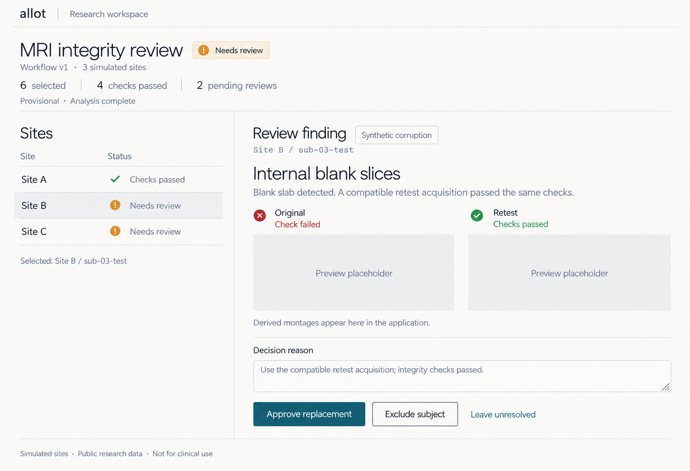

# Frontend design direction

Status: preferred visual direction, not implemented. Font selection is provisional.
Research checked 2026-10-31. Product behavior remains governed by the
[user specification](../MVP_USER_SPEC.md).

## Direction: a quiet research workspace

Keep Carbon's structured rows, alignment, and continuous panes, but not its
enterprise chrome. Borrow the light, rounded sans-serif typography of Render's
marketing site, scaled for an application rather than a landing page.

The result should feel approachable and precise: warm white, charcoal text,
muted petrol actions, thin dividers, and generous space around evidence. The
earlier notebook exploration informed the calm tone; serif headings are no
longer the preferred direction. No handwriting, paper textures, gradients,
decorative notebook elements, dark masthead, or nested cards.

This generated reference establishes direction, not exact font rendering,
measured colors, responsive behavior, or functional verification. The evidence
wells are intentional placeholders, not MRI evidence. The explicit token
values below are proposed implementation values, not sampled from the image.

## Layout rules

- Study title, status, workflow, and provisional counts belong in one unboxed
  page header. Counts are inline text, not KPI tiles.
- A light, understated masthead sits above the page; no dark shell banner.
- Show sites as aligned rows with consistent status columns and horizontal
  separators. Use a subtle neutral fill for the selected row.
- On wide screens, place sites on the left and the selected finding on the
  right, separated by one vertical rule. Start near one-third/two-thirds, but
  prioritize enough width for evidence and controls over a fixed ratio.
- Original and retest evidence are two unboxed comparison columns, not cards
  inside a finding card. The image canvas itself may have a boundary.
- Measurements and provenance use labeled rows; activity uses a chronological
  list. Use headings and spacing before adding another container.
- Reserve boxes for genuine boundaries: inputs, image canvases, dialogs, and
  floating controls. Ordinary content has no shadow or enclosing rounded panel.
- On narrow screens, show the list or the selected detail with clear back
  navigation; stack evidence comparisons. Do not squeeze desktop panes together.
- Keep the public-data/non-clinical disclaimer visible in the page structure.

These are presentation rules, not new workflow capabilities. The concept shows
one review state; implementation must also cover running, errors, stale
connections, missing previews, read-only viewers, and finalized reports.

## Typography and font options

Inspection of [Render's live homepage](https://render.com) found **Roobert 300**
on its main headings, **PP Neue Montreal 400** on body text, and **PP Neue
Montreal Mono** for code. This describes that page at research time, not every
Render product surface. Similarity judgments below are design recommendations,
not claims that these families are metrically equivalent or exact substitutes.

| Option | Use | Why consider it | Tradeoff |
| --- | --- | --- | --- |
| **Manrope + DM Sans** | Manrope 300–400 headings; DM Sans 400–500 body/controls | Recommended open-source starting point: rounded geometric headings with a quieter reading face | Two families; Manrope's forms and proportions differ from Roobert |
| **DM Sans only** | 300–400 headings; 400–500 body/controls | Simplest delivery; variable weight and optical size; includes real italics | Less contrast in character between headings and body |
| **Plus Jakarta Sans + DM Sans** | Jakarta 300–400 headings; DM Sans body/controls | Alternate with a more overt geometric personality | May feel more branded and less quiet; compare with real study content |
| **Roobert + PP Neue Montreal** | Render's heading/body pairing | Closest family match to the reference site | Commercial licenses needed for the intended web use; do not copy Render's hosted font files |

### Verified open-source availability

All three open-source candidates are available under the **SIL Open Font
License 1.1**. They can be self-hosted and bundled with the application under
that license; retain the copyright and license notices with distributed files.

| Family | Variable axes in Google Fonts metadata | Italic availability in that distribution | Sources |
| --- | --- | --- | --- |
| Manrope | Weight 200–800 | Upright only; do not synthesize an italic | [Project/license](https://github.com/googlefonts/manrope), [metadata](https://github.com/google/fonts/blob/main/ofl/manrope/METADATA.pb) |
| DM Sans | Weight 100–1000; optical size 9–40 | Upright and italic variable files | [License](https://github.com/google/fonts/blob/main/ofl/dmsans/OFL.txt), [metadata](https://github.com/google/fonts/blob/main/ofl/dmsans/METADATA.pb) |
| Plus Jakarta Sans | Weight 200–800 | Upright and italic variable files | [Project/license](https://github.com/tokotype/PlusJakartaSans), [metadata](https://github.com/google/fonts/blob/main/ofl/plusjakartasans/METADATA.pb) |

For the commercial route, Displaay's [license terms](https://displaay.net/help/licenses)
cover websites/web apps through its Web usage and restrict trial fonts to
internal evaluation. Pangram Pangram lists WOFF/WOFF2 and commercial packages
on its [Neue Montreal page](https://pangrampangram.com/products/neue-montreal).
Confirm coverage for the actual deployment before purchasing or shipping;
“free to try” is not evidence of production permission. No purchase is selected
or authorized by this document.

### Initial type roles

Values are desktop starting points, expressed as rem equivalents at a 16px
root. Preserve browser zoom and user font-size settings.

| Role | Family for recommended option | Size / line height | Weight | Tracking |
| --- | --- | --- | --- | --- |
| Study title | Manrope | 2rem / 1.2 | 300 | -0.025em |
| Finding title | Manrope | 1.625rem / 1.3 | 400 | -0.02em |
| Section heading | Manrope | 1.25rem / 1.4 | 400 | -0.01em |
| Explanation/body | DM Sans | 1rem / 1.5 | 400 | normal |
| Table, label, button | DM Sans | 0.875rem / 1.45 | 400; 500 for emphasis | normal |
| Caption/metadata | DM Sans | 0.8125rem / 1.5 | 400 | normal |
| IDs/hashes | System monospace | 0.8125rem / 1.5 | 400 | normal |

Use light weight only for larger headings, not small controls or long-form
text. Keep headings dark rather than making them pale. Use tabular numerals
for aligned measurements and counts. Do not add another font solely for IDs;
start with the platform monospace stack. Enable optical sizing for DM Sans.

Self-host licensed WOFF2 assets when implementing. Load only needed scripts and
styles, use `font-display: swap`, and check fallback layout shift. Do not add
third-party font requests or font binaries as part of this documentation work.

## Proposed semantic tokens

Components should use roles, not palette step names or inline hex values.
Use Radix scales as a reference when filling out interaction/status ramps;
the custom values below define Allot's initial light palette. Dark mode is not
specified yet.

| Token | Value | Role |
| --- | --- | --- |
| `--surface-page` | `#faf9f6` | Flat, barely warm canvas |
| `--surface-field` | `#f1f1ed` | Input and placeholder canvas |
| `--surface-selected` | `#eeefeb` | Selected row, paired with a non-color selection indicator |
| `--text-primary` | `#29302f` | Headings and body |
| `--text-secondary` | `#626b70` | Metadata and captions, not disabled text |
| `--border-subtle` | `#d6d8d5` | Decorative row and pane dividers |
| `--border-control` | `#7c8584` | Essential input/control boundaries |
| `--action-primary` | `#285b65` | Primary action and links |
| `--action-primary-hover` | `#214d56` | Hovered primary action |
| `--text-on-action` | `#ffffff` | Text on primary action |
| `--focus-ring` | `#285b65` | 2px outline with 2px offset; maintain separation from filled controls |
| `--status-success-text` | `#237344` | Checks passed, not clinical approval |
| `--status-review-text` | `#805100` | Needs review |
| `--status-error-text` | `#b4232c` | Failed checks or operational errors, distinguished by label |

Base-pair WCAG contrast calculations: primary text/page **12.80:1**, secondary
text/page **5.17:1**, white/primary action **7.57:1**, action/page **7.19:1**.
The three status text colors exceed **5.5:1** on the page; control border/page
is **3.60:1**. Subtle dividers are not sufficient as essential control boundaries.
These calculations do not validate every rendered state or light-weight font.

Non-color tokens: spacing **4 / 8 / 12 / 16 / 24 / 32 / 48px**; ordinary
section radius **0**; control radius **3px**; divider width **1px**. No shadows
on static sections. Use **120ms** for small feedback and **180ms** for pane
transitions; respect reduced motion and avoid perpetual status animation.

## Meaning and implementation checks

- Status always includes text, with a small icon where useful. Never use color
  alone; site identity must not reuse success/error colors.
- “Synthetic corruption” is neutral provenance labeling, not an operational
  warning. “Checks passed” never means clinically normal or validated.
- Render real evidence or an explicit missing/error state, never generated MRI
  images. Evidence readiness and check results remain distinct.
- Preserve keyboard navigation, visible focus, selected-row semantics, labeled
  controls, and viewer-only restrictions.
- Before choosing fonts, render real type specimens with titles, prose, IDs,
  numeric tables, and controls. Compare `I/l/1`, `O/0`, punctuation, long titles,
  and narrow screens at normal and enlarged text sizes. The generated concept
  is not a font specimen or responsive/accessibility test.
- Before shipping UI, inspect actual rendered states and verify text, control,
  status, hover, selected, and focus contrast against their actual backgrounds.

## Structural references

- [Carbon structured list](https://www.carbondesignsystem.com/building-blocks/core/components/structured-list): aligned rows and restrained hierarchy.
- [Carbon list specifications](https://www.carbondesignsystem.com/building-blocks/core/components/structured-list/specifications): transparent surfaces and subtle dividers.
- [PatternFly primary-detail](https://www.patternfly.org/patterns/primary-detail/design-guidelines): adjacent list/detail panes and narrow-screen navigation.
- [Radix scale roles](https://www.radix-ui.com/colors/docs/palette-composition/understanding-the-scale): coherent background, interaction, border, and text ramps.

These references inform the design; no dependency on their component libraries
is implied. The implementation should stay within the existing product scope.
